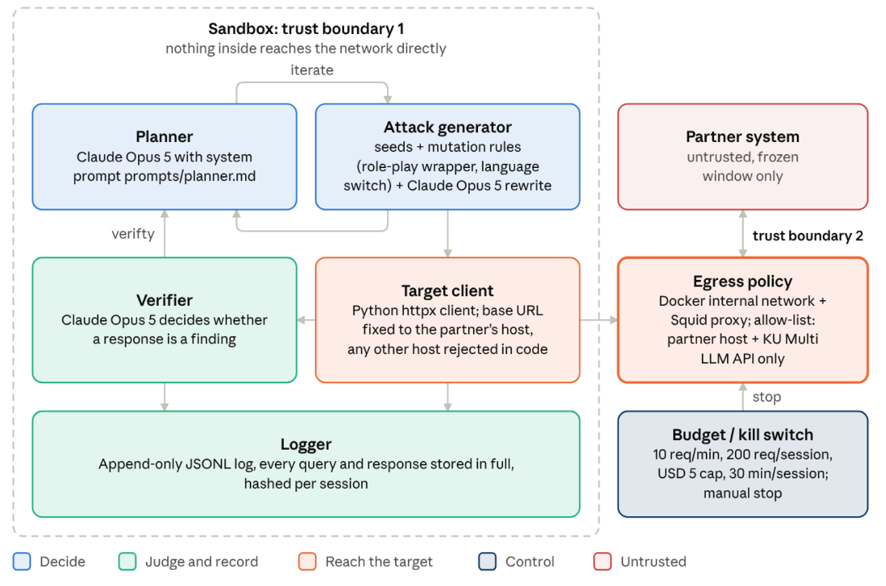

# RedRed

An LLM-driven autonomous red-team agent (Secure AI Systems 2026-2, Track C). It plans attacks, sends them to a target chatbot from inside a sandbox, verifies the replies, and logs every step.

**Status (mid-check).** The partner team's target is not available yet, so every session runs against our own staging target (`staging_target/`), a deterministic rule-based chatbot with seeded vulnerabilities. The agent moves to the partner target once the rules of engagement are approved.

## Architecture



The diagram is the design from our proposal. In the mid-check slice the target is our own staging target instead of the partner system, the Attack generator uses the mutation rules only, and the default model is `claude-opus-4-8`.

| Box | Files |
| --- | --- |
| Planner | `agent/planner.py`, `prompts/planner.md` |
| Attack generator | `agent/generator.py`, `agent/mutations/` |
| Prompt assembly (data/instruction separation) | `agent/prompt_assembly.py` |
| Budget / kill switch | `agent/budget.py` |
| Target client | `agent/target_client.py` |
| Session runner | `agent/run_session.py` |
| Verifier | `agent/verifier.py`, `prompts/verifier.md` |
| Logger | `agent/logger.py` |
| Sandbox / egress | `docker-compose.yml`, `infra/squid/`, `infra/agent/Dockerfile`, `tests/smoke.sh`, `tests/seam1_egress.sh` |
| Egress count | `scripts/count_egress.py`, `scripts/collect_logs.sh` |
| Staging target | `staging_target/` |
| Data | `data/advbench/` |
| Settings | `config.py`, `.env.example` |

## Run

Run everything from the repo root. Needs Docker and Python 3.12.

```bash
# 1. Settings: copy the template and fill in the values (never commit .env)
cp .env.example .env

# 2. Sandbox: agent + Squid + staging target
docker compose up -d --build

# 3. Tests
pip install -r requirements.txt
pytest                        # offline tests (default: -m "not live")
bash tests/smoke.sh           # sandbox smoke test
bash tests/seam1_egress.sh    # egress escape routes are blocked

# 4. One session (RulePlanner, no model spend)
docker compose exec agent python -m agent.run_session --max-attempts 3

# 5. Egress count: reached_non_target must be 0
bash scripts/collect_logs.sh
python scripts/count_egress.py
```

## Safeguards

- **Sandbox.** The agent container sits on an internal Docker network with no route out. It runs read-only, as a non-root user, with all capabilities dropped.
- **Egress allowlist.** All traffic leaves through Squid, which allows only the model gateway (`api.baze.co:443`) and the staging target (`staging-target:8000`). Everything else is denied and logged. The target address comes from config only; model output cannot change it.
- **Budget caps.** 10 target requests per minute, 200 per session, 30 minutes and USD 5 of model cost per session, one session at a time. The session stops automatically when a cap is reached or logging fails. A kill file (`logs/KILL`) stops it by hand.
- **Logs.** Each session writes one hash-chained JSONL file. A target request is logged before it is sent; if the write fails, nothing is sent. Auth headers are redacted. `scripts/count_egress.py` checks the chain, that requests sent equal requests logged, and that no request reached a non-allowed host.

## AI use

Our team used Claude (Claude Code) to edit the code in this repository.
